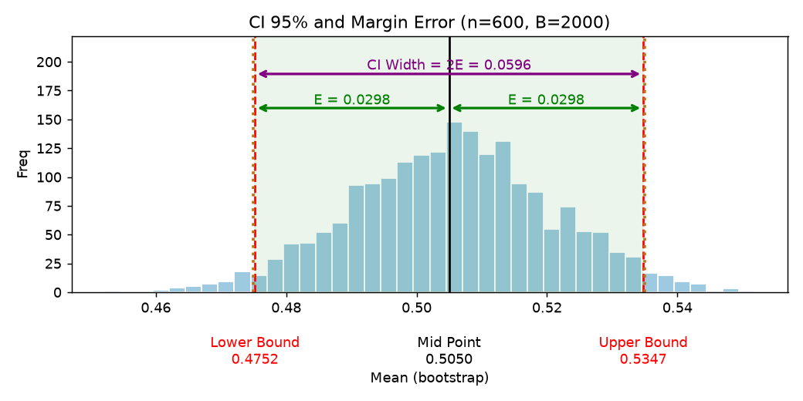
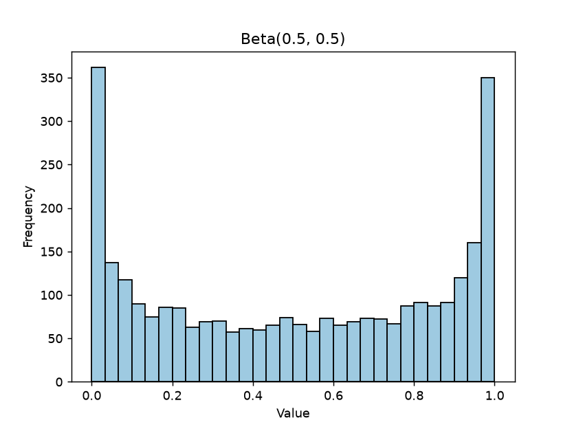

# Bootstrap Sample Size

Find the **minimum sample size** needed to reach a target margin error, using the bootstrap method.

Instead of relying on a closed-form formula that assumes a normal distribution, this project resamples your own data and measures how wide the confidence interval is at each sample size. The search stops at the first size that is precise enough. It works for any metric (mean, median, standard deviation, ...) and for data that is not normally distributed.



## How it works

1. Start at a sample size of `n_steps` (e.g. 100).
2. Draw `n_bootstrap` resamples of that size from the data, with replacement.
3. Compute the chosen metric (default: mean) on every resample. This gives the bootstrap distribution.
4. Take the percentile interval of that distribution (e.g. 2.5% and 97.5% for 95% confidence).
5. The **margin error** is half of the interval width: `E = (upper - lower) / 2`.
6. If `E` is smaller than the target, return the current sample size. Otherwise add `n_steps` and repeat from step 2.

## Example

The demo data is 3,000 values from a **U-shaped Beta(0.5, 0.5)** distribution. It is far from normal, which makes it a good test for a bootstrap approach.



```python
import numpy as np
from bootstrap_sample_size import BootstrapSampleSize

data = np.random.default_rng(42).beta(a=0.5, b=0.5, size=3000)

model = BootstrapSampleSize(
    data=data,
    n_bootstrap=2000,
    n_steps=100,
    metrics=np.mean,
    margin_error=0.03,
    confidence=0.95,
    seed=42,
)

n_sample = model.find_n_sample()          # -> 600
n_sample = model.find_n_sample(plot=True)  # same, with a plot at every step
```

With `seed=42`, the minimum sample size found is **600**, where the margin error is about 0.0298 (target: 0.03).

As a sanity check, the standard deviation of Beta(0.5, 0.5) is about 0.354. The classic formula `n = (1.96 * sd / E)^2` gives roughly 534, which is close to the bootstrap result. The difference comes from the step size (100) and the randomness of resampling.

## Parameters

| Parameter | Default | Description |
|---|---|---|
| `data` | required | 1-D numeric array to resample from |
| `n_bootstrap` | `1000` | Number of resamples at each sample size |
| `n_steps` | `10` | Starting sample size and increment per iteration |
| `metrics` | `np.mean` | Function that takes an array and returns one number (`np.median`, `np.std`, or your own) |
| `margin_error` | `0.03` | Target margin error, in the same scale as the data |
| `confidence` | `0.95` | Confidence level of the interval |
| `max_steps` | `100_000` | Upper limit for the sample size; `ValueError` is raised if it is exceeded |
| `seed` | `None` | Seed for reproducible results |

Using a custom metric:

```python
model = BootstrapSampleSize(data, metrics=np.median, margin_error=0.02, seed=1)
model.find_n_sample()
```

## Installation

```bash
git clone <your-repo-url>
cd <your-repo-folder>
python -m venv .venv
.venv\Scripts\activate        # Windows
# source .venv/bin/activate   # macOS / Linux
pip install -r requirements.txt
```

Requires Python 3.9 or newer.

## Project structure

```
.
├── bootstrap_sample_size.py          # BootstrapSampleSize class
├── run_example.py                    # Runnable example script
├── bootstrap_sample_size_demo.ipynb  # Walkthrough notebook
├── images/             # Figures used in this README
├── requirements.txt
├── LICENSE
└── README.md
```

## Notes and limitations

- The margin error is an **absolute** value, so choose it according to the scale of your data.
- Resampling is done with replacement, so the sample size can exceed the number of rows in `data`. The result then describes the precision you would expect from a fresh sample of that size, assuming your data represents the population well.
- For metrics whose spread does not shrink as the sample grows (e.g. `np.max`), the target may never be reached and `ValueError` is raised at `max_steps`.
- Runtime grows with `n_bootstrap` and with the number of steps. Increase `n_steps` for a faster, coarser search.

## License

Released under the [MIT License](LICENSE).
